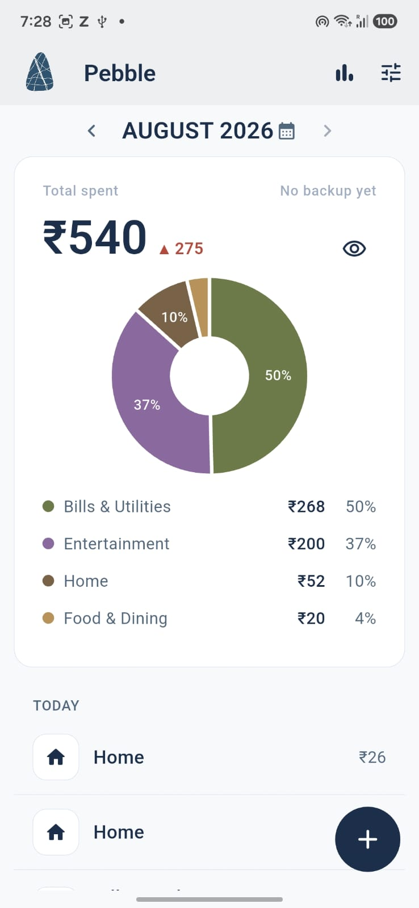
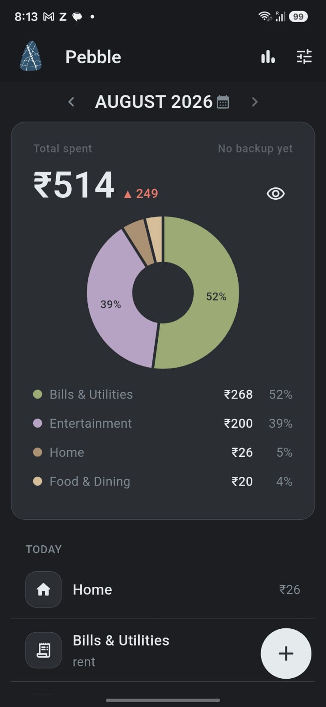
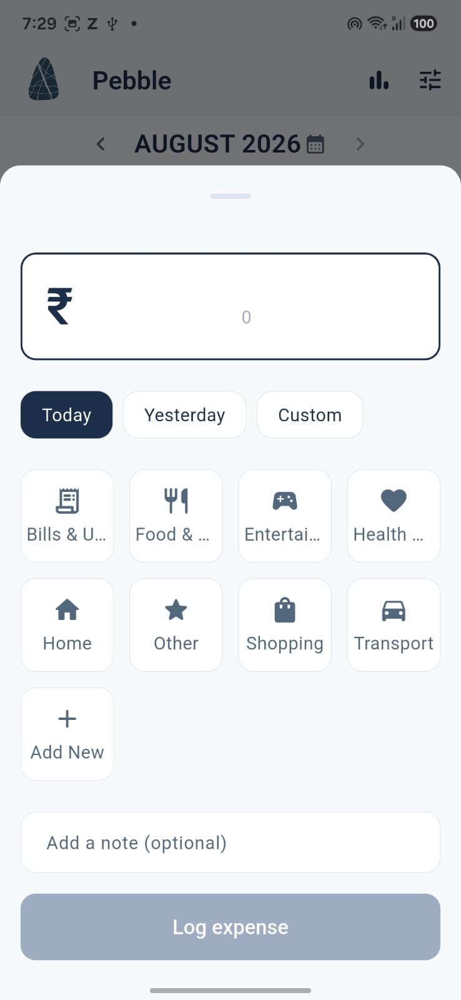
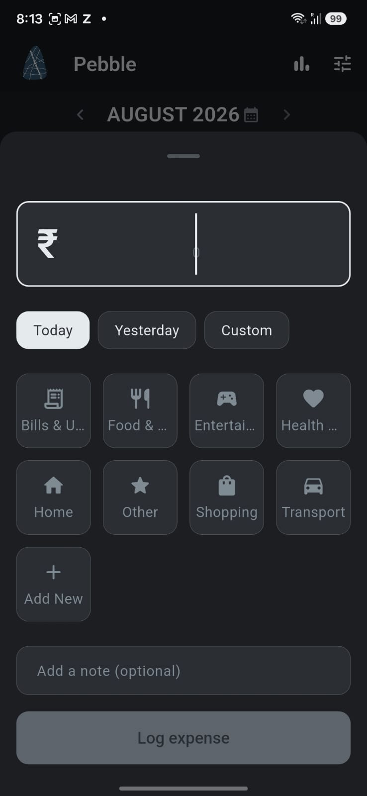
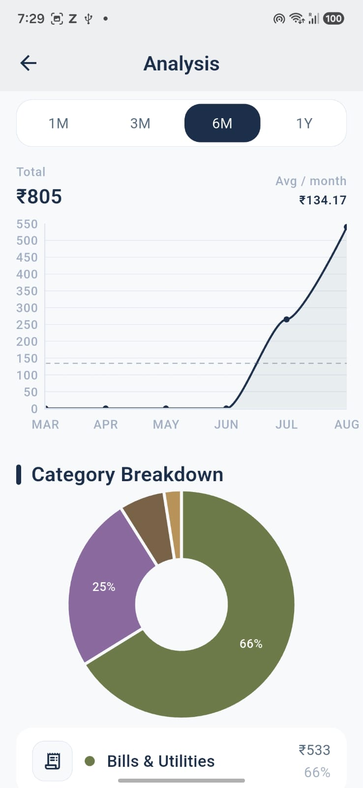
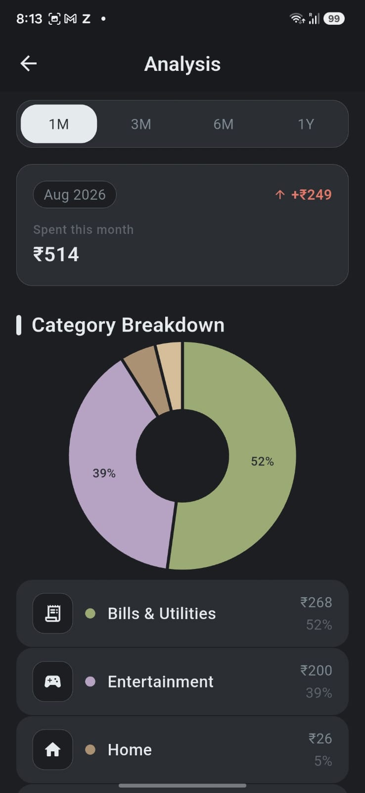
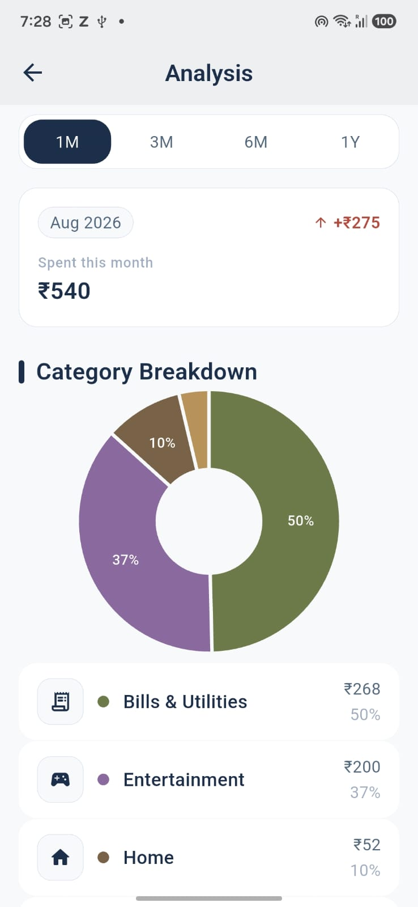
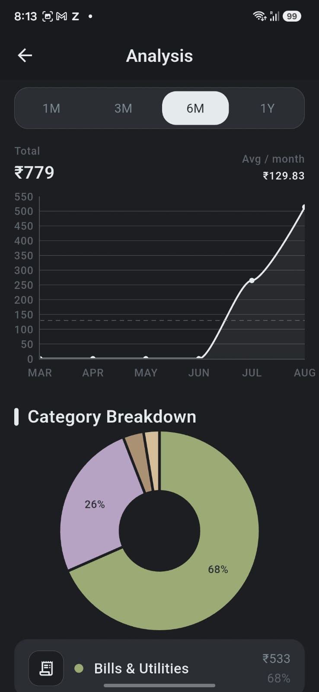
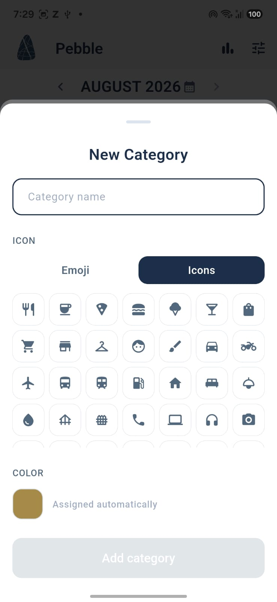
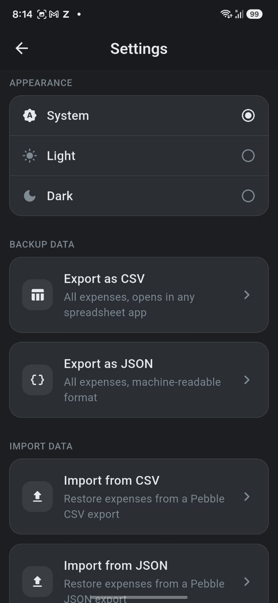

<div align="center">
  

  # Pebble

  **The private expense tracker that gets out of your way.**

  A calm, fast, manual-only money journal for people who want to *know* where their money goes — without giving a single byte of it to the cloud.

  <p>
    
    
    
  </p>
</div>

---

## ✨ Why Pebble?

Most finance apps want your email, your bank login, and a subscription. **Pebble wants none of that.**

Pebble is built on a single idea: *your spending is your business.* It runs entirely on your device, opens to a clean monthly view, and lets you log an expense in three taps. No accounts. No sync. No ads. No nudges to upgrade.

| | Pebble | Typical finance app |
|---|:---:|:---:|
| Account required | ❌ Never | ✅ Usually |
| Data leaves your phone | ❌ Never | ⚠️ Often |
| Subscriptions | ❌ None | 💸 Common |
| Time to log an expense | ⏱️ ~3 seconds | 🐌 Form-heavy |
| Works offline | ✅ Always | ⚠️ Sometimes |

---

## 📸 A look inside

Pebble ships a restrained, Apple-infused design system that feels right in **both light and dark**. Every screen below shows the light variant first, then its dark counterpart.

### 🏠 Home — your month, at a glance

Month header, a big total, an at-a-glance category donut, and a day-grouped list. Tap **"+"** to log a spend in seconds.

<table>
  <tr>
    <td align="center"><b>Light</b></td>
    <td align="center"><b>Dark</b></td>
  </tr>
  <tr>
    <td></td>
    <td></td>
  </tr>
</table>

### ➕ Log it fast

One bottom sheet handles both adding and editing: pick a date, tap a category, type the amount, add an optional note. That's it.

<table>
  <tr>
    <td align="center"><b>Light</b></td>
    <td align="center"><b>Dark</b></td>
  </tr>
  <tr>
    <td></td>
    <td></td>
  </tr>
</table>

### 📊 Understand your habits

Interactive trend lines, month-over-month deltas, and a category breakdown — across **3M**, **6M**, or **1Y**.

<table>
  <tr>
    <td align="center"><b>Light</b></td>
    <td align="center"><b>Dark</b></td>
  </tr>
  <tr>
    <td></td>
    <td></td>
  </tr>
  <tr>
    <td></td>
    <td></td>
  </tr>
</table>

### ⚙️ Settings — yours to control

Switch appearance, export your data as CSV or JSON, and import it back whenever you like.

<table>
  <tr>
    <td align="center"><b>Light</b></td>
    <td align="center"><b>Dark</b></td>
  </tr>
  <tr>
    <td></td>
    <td></td>
  </tr>
</table>

---

## 🚀 Features

- **🔒 Truly private** — 100% on-device storage via Hive. Zero network calls, zero tracking, zero accounts.
- **⚡ Three-tap entry** — Date → Category → Amount. Optional note. Done. No page navigation, no fuss.
- **📊 Beautiful analysis** — Trend lines, averages, and category breakdowns across 3 / 6 / 12 months.
- **🥧 Category insights** — A clean donut shows where your money actually goes, with month-over-month deltas.
- **🌗 Light & dark** — A restrained, Apple-infused design system that respects your system theme.
- **🗂️ Custom categories** — Add the categories that fit your life.
- **💾 Own your data** — Export everything as **CSV** or **JSON**, or import it back. Your backup, your rules.
- **📅 Effortless navigation** — Swipe between months or jump straight to any month with the calendar picker.
- **🧊 Settled history** — Past months are read-only by design, so closed months stay exactly as you left them.

---

## 🛠️ Built with

| Concern | Choice |
|---|---|
| Framework | [Flutter](https://flutter.dev) |
| State management | `flutter_bloc` (BLoC / Cubit) |
| Local storage | `hive` + `hive_flutter` |
| Charts | `fl_chart` |
| Export / Import | `file_picker` for import, `path_provider` for app file storage |
| Theme persistence | `shared_preferences` |

Architected around SOLID principles: immutable states, a swappable `ExpenseRepository`, and small, composable widgets. No over-engineering — just clean, testable code.

---

## 🏁 Getting started

> Requires the [Flutter SDK](https://docs.flutter.dev/get-started/install) (stable channel) and a connected device or emulator.

```bash
# Clone the repository
git clone <your-repo-url> pebble
cd pebble

# Install dependencies
flutter pub get

# Run on a connected device / emulator
flutter run
```

### Run tests

```bash
flutter test
```

---

## 📤 Backing up your data

Open **Settings → Backup Data**:

- **Export as CSV** — opens in any spreadsheet app.
- **Export as JSON** — machine-readable, perfect for your own scripts.
- **Import from CSV / JSON** — restore or move your data. Unknown categories are created automatically.

Everything is shared through your phone's native share sheet. Nothing is uploaded anywhere.

---

## 🗺️ Roadmap

- **v1.1** — Home / lock-screen widgets (native iOS & Android).
- Richer trends and smarter insights.
- More import/export flexibility.

See `expense-tracker-spec.md` for the full product specification.

---

## 🤝 Contributing

Pebble is a personal, opinionated tool — but ideas and improvements are welcome. Open an issue or a pull request and let's make quiet, private money tracking even better.

---

<div align="center">

  **Pebble** — *Manual-only expense tracking. Private, local, fast entry. Your data never leaves your device.*

  Made with Flutter 💙

</div>
